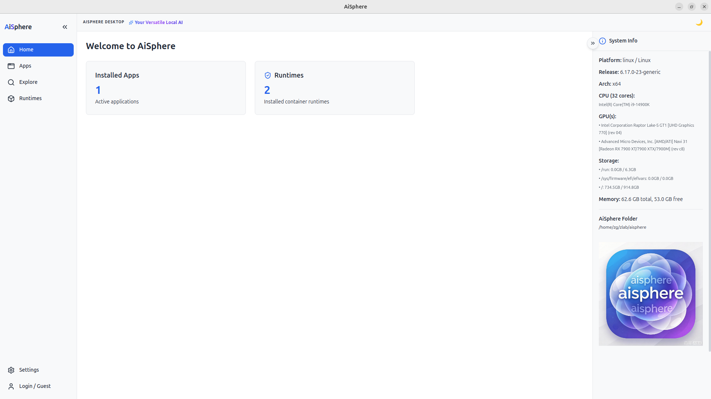
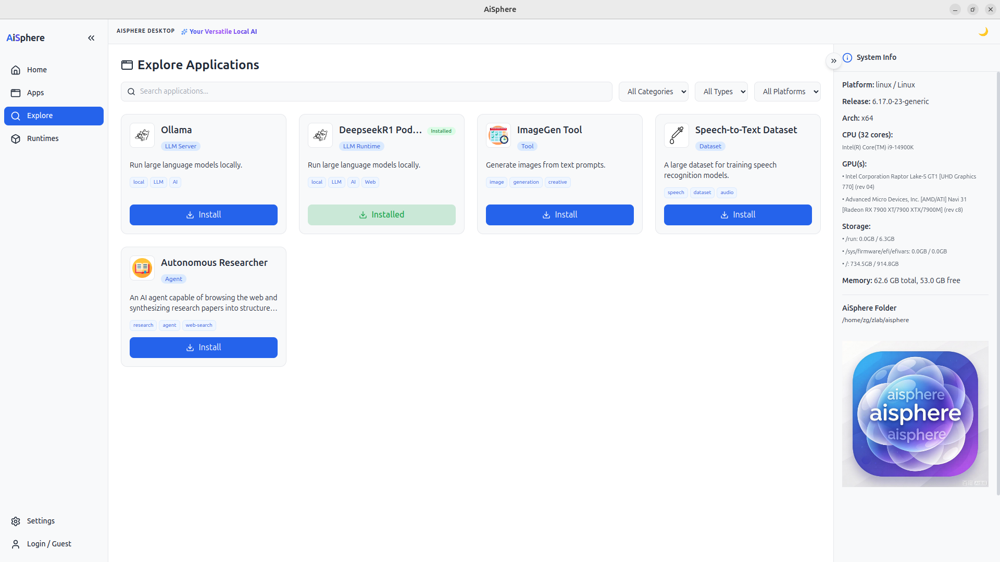
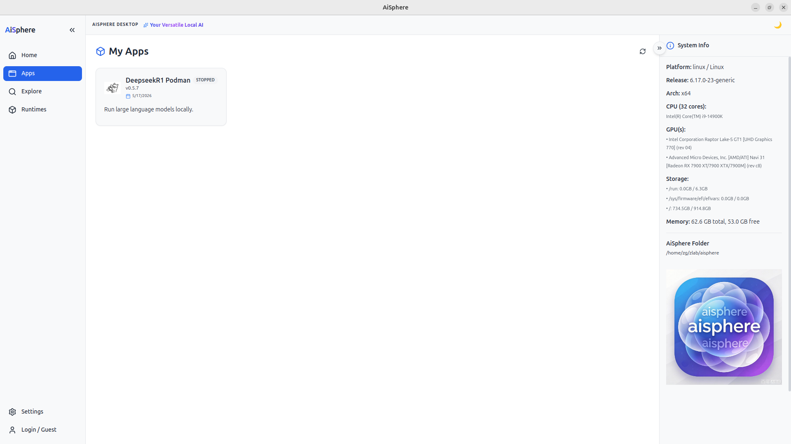
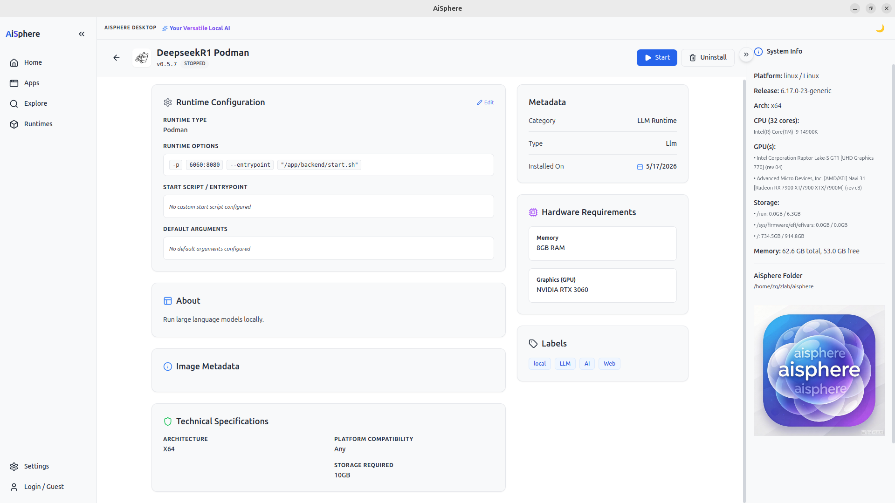
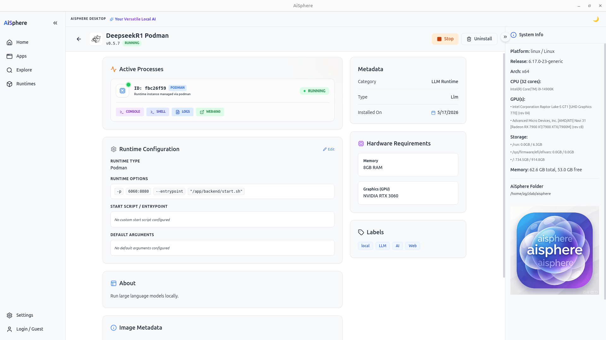
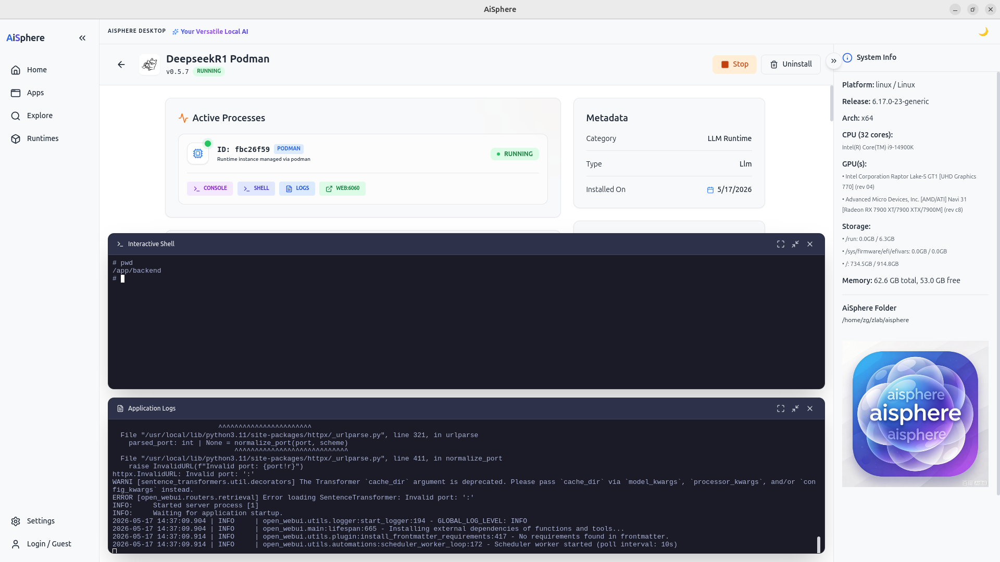
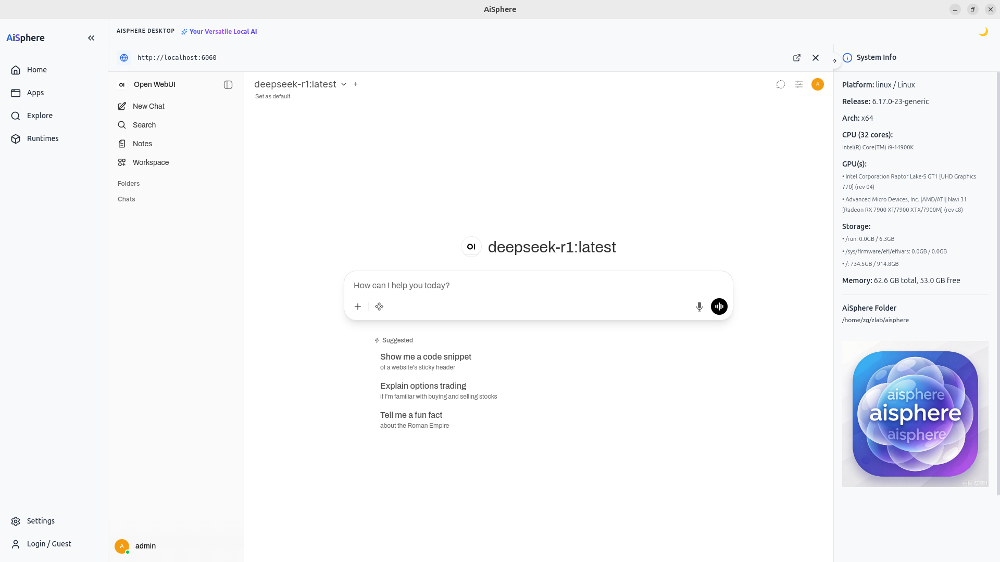
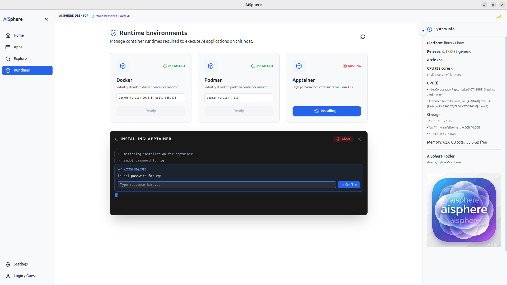
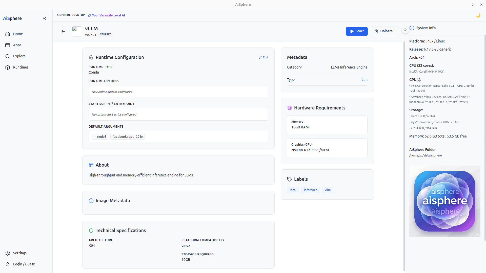

# AiSphere Desktop

**AiSphere Desktop** is a versatile, privacy-focused local AI application manager. It empowers users to discover, install, and manage a wide array of AI tools—including Large Language Models (LLMs), autonomous agents, and datasets—directly on their own hardware.

By leveraging local runtimes (containers, singularity or natives/conda), AiSphere ensures that your data and models never leave your machine, providing a secure and high-performance environment for modern AI workflows.

## Visual Overview

Below are some highlights of the AiSphere Desktop interface:

### 1. The Home Dashboard

*A unified view of your local AI ecosystem, showing active applications and system health.*

### 2. Application Exploration

*Discover new AIs to install locally, categorized by type (LLM, Agent, Tool) with detailed hardware requirement checks.*

### 3. Your AI Apps


### 4. Start & Enjoy AIs


*Manage running instances with built-in terminals and one-click access to local web services.*



### 4. Runtime Management

*Automated checks and installation guides for required runtimes like Podman and Apptainer.*


## Core Features

*   **Local Execution**: Run powerful AI models like Ollama, DeepSeek-R1, and custom agents without cloud dependencies.
*   **Multi-Runtime Support**: Native integration with **Podman** and **Apptainer** (Singularity) to handle various container formats and isolation requirements.
*   **Integrated Workspace**:
    *   **Interactive Shell**: Directly attach to running containers.
    *   **Real-time Logs**: Monitor installation and execution processes with a resizable terminal.
    *   **Internal Web View**: Access web-based AI interfaces (like Open WebUI) directly inside the desktop app.
*   **Hardware Monitoring**: Real-time insights into your system's CPU, GPU (NVIDIA/Apple Silicon/Linux), Memory, and Storage availability.
*   **Global App Store**: An "Explore" section to discover new AI tools tailored for your specific hardware architecture.
*   **App management**: Select multiple catalog apps to install, or select installed apps to start, stop, or uninstall them in batches. Each installed instance gets a unique ID, and a catalog entry can only be installed once.
*   **Runtime setup**: When an Explore app needs a runtime that is not installed, AiSphere can install it and continue the app installation. Configure **Settings → Runtime auto-install** to ask every time (default), install automatically, or never install automatically.

More are on the way...vLLM & SGLang...


## Getting Started

To begin your local AI journey, ensure you have a supported container runtime installed via the **Runtimes** tab, then head over to **Explore** to install your first AI application.

## Share files on your local network

Install **AiSphere LAN NAS** from **Explore**, then open it in **My Apps** and choose **Manage share**. Select the folder to share and start the service. AiSphere shows an address for each available private IPv4 network; open one of those addresses in a browser on another device to browse, download, and upload files.

Password authentication is enabled by default. Each time the service starts, AiSphere generates a new password; use the username `aisphere` when the browser prompts for credentials. Authentication can be disabled in the share settings, but then any device on the local network can read and upload files in the selected folder. The service uses HTTP without encryption, so use it only on a trusted network. The server stops when AiSphere quits.

For a Docker-based alternative, install **File Browser NAS** from **Explore**. Its files, settings, and database are persisted in its AiSphere app data folder; the web UI is available at `http://localhost:8093` after starting the app. Docker must be installed and running.

## Build and Run on Windows

The repository ships self-contained scripts for Windows 11. They bootstrap a portable
Node.js and Yarn into `.tools/` when no suitable system Node.js is available, so the
only prerequisite is Windows PowerShell 5.1+ (included with Windows 11) and an internet
connection for the first run.

From the repository root, double-click the `.cmd` files or run them from a terminal:

| Command | What it does |
| --- | --- |
| `scripts\windows\setup.cmd` | Downloads Node.js/Yarn if needed, installs dependencies, and prepares the icons. Run this first. |
| `scripts\windows\dev.cmd` | Starts Vite and launches Electron in development mode (hot reload). |
| `scripts\windows\build.cmd` | Builds the renderer/main process and packages a Windows installer. |

Build options (PowerShell):

```powershell
# Build the NSIS installer for x64 (default)
.\scripts\windows\build.ps1 -Arch x64

# Build an unpacked application folder instead (faster, no installer)
.\scripts\windows\build.ps1 -Kind dir

# Build for ARM64
.\scripts\windows\build.ps1 -Arch arm64

# Reinstall dependencies and/or skip the TypeScript check
.\scripts\windows\setup.ps1 -ForceInstall
.\scripts\windows\build.ps1 -SkipTypeCheck
```

Outputs are written to `release/`:

* `release\aisphere-<version>-win-<arch>.exe` – the installer.
* `release\win-<arch>-unpacked\aisphere.exe` – the unpacked app, runnable without installing.

Notes:

* Dependencies are installed with `--ignore-scripts`; the scripts then run only the
  installers that are actually needed (Electron download, node-pty, esbuild). This keeps
  the build working without Visual Studio C++ build tools or Python.
* Closing the main window hides AiSphere to the system tray instead of quitting. Click the
  tray icon (or launch the app again) to reopen the window; use **Quit AiSphere** in the
  tray menu to exit completely.
* By default, quitting AiSphere stops its running apps and managed Docker/Podman engines.
  Configure **Settings → When quitting AiSphere** to ask each time, stop automatically,
  or leave them running. System-installed engines are never stopped.
* `.tools/` is ignored by git and can be deleted at any time to force a clean bootstrap.
* Portable-tool versions can be overridden with the `AISPHERE_NODE_VERSION` environment
  variable (default `v24.22.2`).

## Authors
- <zegang.luo@qq.com>
- You are welcomed to join AiSphere to make everyone enjoy AI

---
*AiSphere Desktop - Your Versatile Local AI*