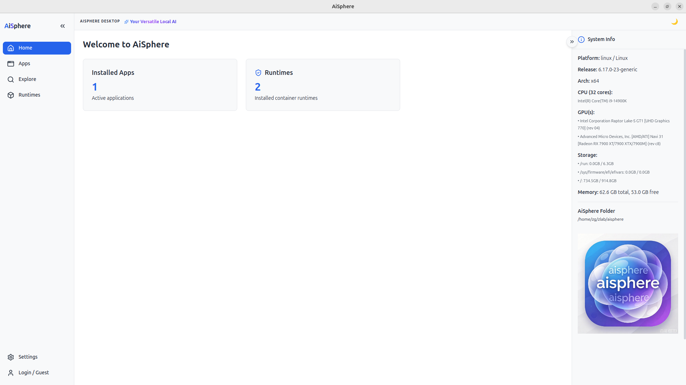
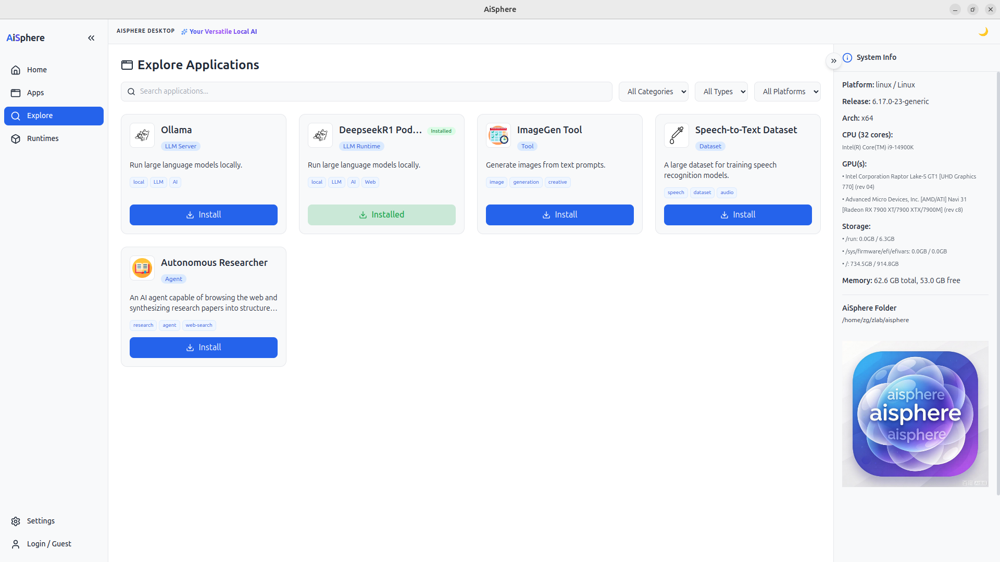
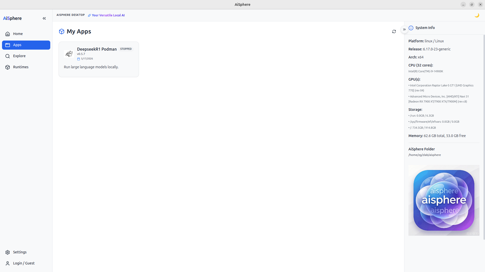
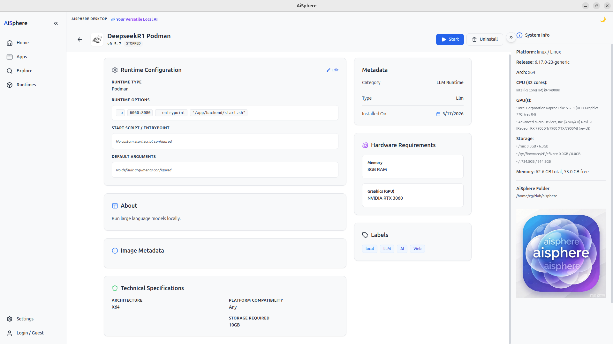
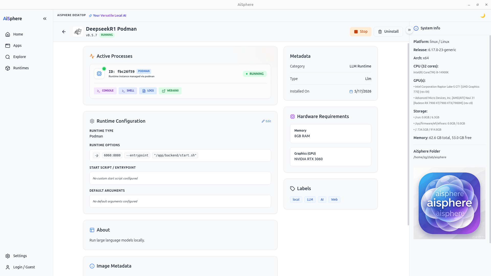
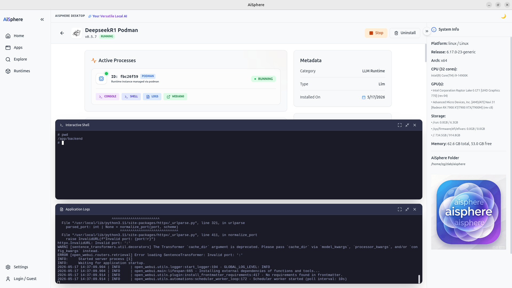
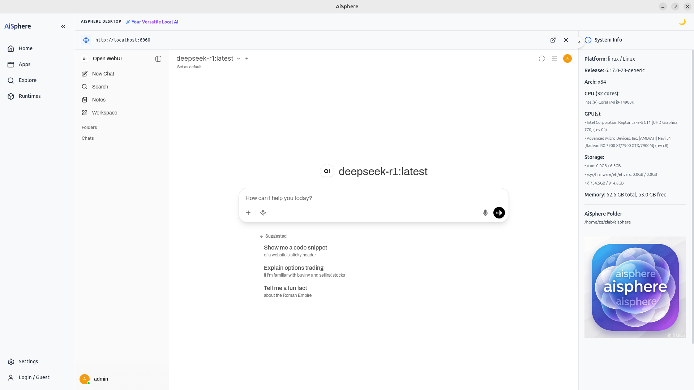
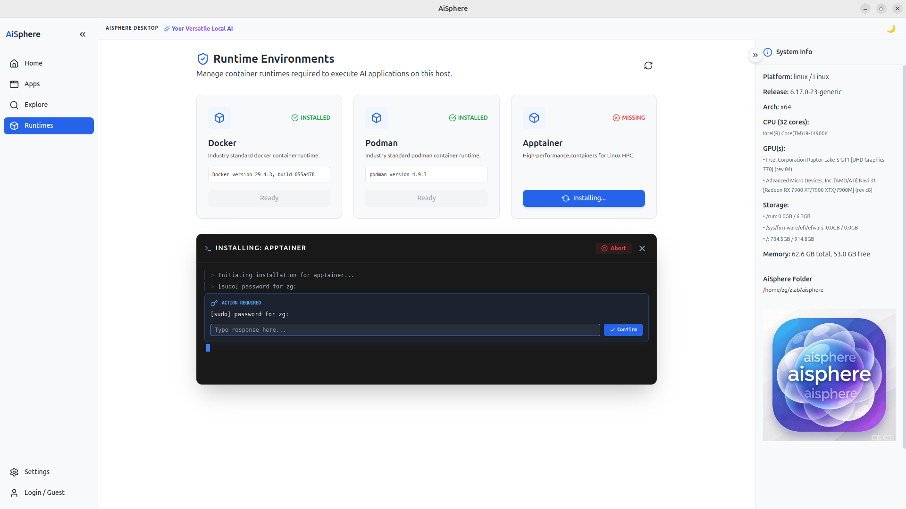
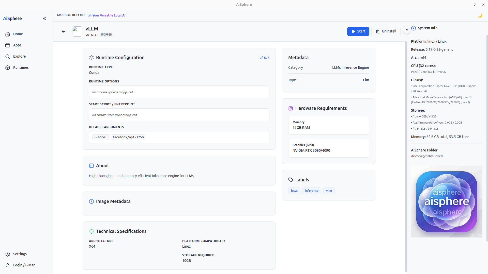

# AiSphere Desktop

**AiSphere Desktop** is a versatile, privacy-focused local AI application manager. It empowers users to discover, install, and manage a wide array of AI tools—including Large Language Models (LLMs), autonomous agents, and datasets—directly on their own hardware.

By leveraging local runtimes (containers, singularity or natives/conda), AiSphere ensures that your data and models never leave your machine, providing a secure and high-performance environment for modern AI workflows.

## Visual Overview

Below are some highlights of the AiSphere Desktop interface:

### 1. The Home Dashboard

*A unified view of your local AI ecosystem, showing active applications and system health.*

### 2. Application Exploration

*Discover new AIs to install locally, categorized by type (LLM, Agent, Tool) with detailed hardware requirement checks.*

### 3. Your AI Apps

### 4. Start & Enjoy AIs

*Manage running instances with built-in terminals and one-click access to local web services.*

### 4. Runtime Management

*Automated checks and installation guides for required runtimes like Podman and Apptainer.*

## Core Features

*   **Local Execution**: Run powerful AI models like Ollama, DeepSeek-R1, and custom agents without cloud dependencies.
*   **Multi-Runtime Support**: Native integration with **Podman** and **Apptainer** (Singularity) to handle various container formats and isolation requirements.
*   **Integrated Workspace**:
    *   **Interactive Shell**: Directly attach to running containers.
    *   **Real-time Logs**: Monitor installation and execution processes with a resizable terminal.
    *   **Internal Web View**: Access web-based AI interfaces (like Open WebUI) directly inside the desktop app.
*   **Hardware Monitoring**: Real-time insights into your system's CPU, GPU (NVIDIA/Apple Silicon/Linux), Memory, and Storage availability.
*   **Global App Store**: An "Explore" section to discover new AI tools tailored for your specific hardware architecture.

More are on the way...vLLM & SGLang...

## Getting Started

To begin your local AI journey, ensure you have a supported container runtime installed via the **Runtimes** tab, then head over to **Explore** to install your first AI application.

## Authors
- <zegang.luo@qq.com>
- You are welcomed to join AiSphere to make everyone enjoy AI

---
*AiSphere Desktop - Your Versatile Local AI*